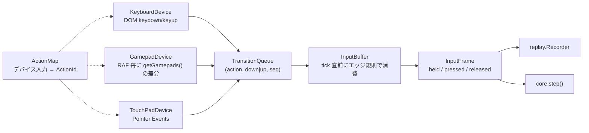

# 入力層と操作感プロファイル

- 版: 設計初版
- 更新日: 2026-11-14（M1-3 で 6 章と 8 章、M1-4 で 5 章と 11 章を実装に合わせて詳細化）
- 根拠: [ADR-0008](decisions/ADR-0008-input-architecture.md)、[ADR-0003](decisions/ADR-0003-fixed-timestep-interpolation.md)、[ADR-0002](decisions/ADR-0002-fixed-point-determinism.md)

## 1. 目標

- キーボード、ゲームパッド、タッチ（仮想パッド）で同じ操作ができ、キーコンフィグできる。
- 入力は tick 単位の `InputFrame` に正規化され、どのデバイス・どのフレームレートでも同じ列になる。
- `InputFrame` の列を記録・再生すれば、画面のない環境で同じ結果が得られる。
- 原作風の固い操作と現代的な操作を、操作感プロファイルの切替だけで行き来できる。

## 2. 層構成



| 層 | パッケージ | 責務 | 決定論の対象 |
| --- | --- | --- | --- |
| Device | `input` | DOM / Gamepad API からの状態遷移をキューに積む | 外 |
| ActionMap | `input` | デバイス入力を `ActionId` に写像。バインドの保存と上書き | 外 |
| InputBuffer | `input`（規則の純粋部分は `core` にも置き、テストする） | tick 直前に `InputFrame` を生成。エッジ規則と再同期 | 外（出力の `InputFrame` から先が対象） |
| Simulation | `core` | `InputFrame` を消費。先行入力、コヨーテタイム、SOCD | 内 |

## 3. Device 層

### 3.1 KeyboardDevice

- `window` の `keydown` / `keyup` を監視し、`KeyboardEvent.code` でバインドを引く。`repeat === true` は無視する。
- バインド済みのキーだけ `preventDefault()`（ブラウザのスクロールやスペースの既定動作を抑止）。未バインドのキーは素通し。
- IME 合成中（`isComposing`）の keydown は無視する。keyup は合成中でも受け取る（解放を取りこぼして押しっぱなしになるのを防ぐ）。
- `blur` と `visibilitychange(hidden)` で再同期トリガ (d)（全 action 解放）。デバイスは押下中のキーの集合も空にする（ほかのウィンドウで離したキーの keyup は届かないため）。
- 複数のデバイスや複数のキーが同じ action に割り当てられているとき、action はそのどれかが押されている間 held になる。デバイスは自分の状態が変わったら `InputBuffer.sourceChanged()` を呼び、InputBuffer が全デバイスの和の変化だけを遷移としてキューに積む（M1-5）。

### 3.2 GamepadDevice

- RAF 毎（ループドライバのフレーム先頭、tick 消化の前）に `navigator.getGamepads()` を読み、前回のスナップショットとの差分を遷移としてキューに積む。120Hz の表示では 1 tick に 2 回ポーリングされ、短いタップも差分として残る。
- `mapping === "standard"` のパッドは `input.json` の `gamepad.standard` を使う（M1）。非標準は M2 の割当 UI で `gamepad.<id>` を作るまで未割当。
- 複数パッド: 最後に入力があったパッドを「アクティブ」とし、他は無視する（設定で固定も可）。
- 接続・切断は `getGamepads()` の結果（`null` または `connected: false`）で検知し、切断時はそのパッド由来の held をすべて up にする（M1-5。イベントはポーリングと同じ情報なので使わない）。
- アクティブなパッドは、新しく押された入力（割当の有無を問わない）があったパッド。同じフレームに複数あれば index の大きい方。
- アナログ軸のデジタル化: 軸値の絶対値が `deadzone`（既定 0.35）以上で down、`release`（既定 0.25）以下で up（ヒステリシス）。方向は符号。左スティックのみ方向に使う。
- 振動は `gamepad.vibrationActuator` があれば任意で使う（設定で切替）。

### 3.3 TouchPadDevice（M2）

- DOM オーバーレイ（`<div>`）に Pointer Events で実装する。`touch-action: none`、`user-select: none`。
- 押下・解放は Pointer イベント発生時に即座にキューへ積む（RAF を待たない）。
- 仕様の詳細は 9 章。

### 3.4 Phaser の入力との関係

- Phaser の `input.keyboard` と `input.gamepad` は無効化する（`GameConfig.input: { keyboard: false, gamepad: false }`）。Phaser は PRE_STEP で入力を更新するため、tick 直前のサンプリングを保証できず、エッジ規則も適用できない。
- メニューも Action 語彙（`confirm` / `cancel` / `menu` / 方向）で操作する。設定画面は DOM。

## 4. ActionMap

### 4.1 Action 語彙（エンジン固定）

| ActionId | 意味 | 備考 |
| --- | --- | --- |
| `left` / `right` | 水平移動 | 同時押しは 6.3 の SOCD 規則 |
| `up` / `down` | 梯子、しゃがみ、ドアに入る、メニュー移動 | `interact.action: "up"` のパックでは `up` が調べる |
| `jump` | ジャンプ | `down + jump` ですり抜け床を降りる |
| `attack` | 攻撃 | |
| `switch` | キャラクター切替 | 1 人構成では無効 |
| `item` | アイテム使用 | |
| `pause` | ポーズ | |
| `menu` | メニュー開閉 | |
| `confirm` / `cancel` | メニュー決定 / 戻る | ゲーム中は `interact.action: "confirm"` のパックで調べる |
| `extra1` 〜 `extra4` | パックが自由に使う | 振る舞いや Action から `inputHeld('extra1')` で参照 |

ビット位置は上表の順に 0 から 15。`InputFrame` の各フィールドは 16 bit のビットマスク。

### 4.2 バインドの形式と優先順位

- 既定: パックの `input.json`。
- ユーザ上書き: `Settings.bindings`（グローバル）→ `Settings.perPack[packId].bindings`。後者が優先。
- 1 つの物理入力を複数の Action に割り当ててよい（例: `KeyZ` を `jump` と `confirm`）。1 つの Action に複数の物理入力を割り当ててもよい。
- 競合は許容し、UI では警告だけ出す。

### 4.3 キーコンフィグ UI（M2-2）

1. 一覧から Action を選ぶ。一覧に出すのは、パックの `input.json` で何かが割り当てられている Action だけ（パックが使わない Action は出さない）。
2. 「押してください」状態になり、次に来たデバイス入力（キー、ボタン、軸の方向）をその Action に追加する。`Escape` は中断（ゲームパッドでは中断できない。もう一度押すと、そのボタンが割り当てられる）。
3. 既存の割当は個別に削除できる。「既定に戻す」でパック既定へ。
4. 保存は即時（`Settings`。ADR-0011 の改訂履歴）。
5. ほかの Action と同じ入力を割り当てたときは、警告を出すだけで許す。

- 開き方: HUD 帯の右端の歯車アイコン、または `menu` の入力。開いている間はゲームを止める（tick を進めない）。閉じたら入力を「すべて離した」状態から始める。
- 画面の言語: ブラウザの言語が日本語なら日本語、それ以外は英語（ADR-0008 の改訂履歴）。
- タッチパッドの表示（自動 / 常に表示 / 表示しない）も同じ画面で選ぶ（9.4）。
- ゲームパッドでの画面の移動は後回し（M2-2 では開く・閉じると入力の取得だけ）。

### 4.4 非標準マッピングのゲームパッド（M2-2）

- `mapping !== "standard"` のパッドは、`Gamepad.id` ごとのユーザの割当（`Settings` の `bindings.gamepad[<id>]`）で読む。割当の無い非標準パッドは読まず、アクティブにもならない。
- 入力 ID はボタンの番号（`button<n>`）と軸の向き（`axis<n>+` / `axis<n>-`）。軸の閾値は `analog` の deadzone と release（ヒステリシス）。
- 標準マッピングのパッドでは、十字キー（ボタン 12〜15）と左スティック（軸 0、1）は `dpad*` と `leftStick*` の名前で取得する。それ以外の軸は `axis<n>±`。

## 5. InputBuffer と `InputFrame`

```ts
interface InputFrame {
  held: number;     // tick 終了時点で押されている action
  pressed: number;  // この tick で down エッジを消費した action
  released: number; // この tick で up エッジを消費した action
}

interface Transition { action: ActionId; kind: 'down' | 'up'; seq: number }
```

### 5.1 エッジ規則

1. Device 層は状態遷移 `(action, down | up, seq)` を発生順にキューへ積む。
2. tick 直前に InputBuffer がキューを先頭から消費する。同一 action の遷移は 1 tick に最大 1 つ。2 つ目に当たった時点で消費を止め、以降は次 tick に持ち越す（全体の順序を保つ）。
3. `held(t)` = 消費後の状態。`pressed(t)` = down を消費した action。`released(t)` = up を消費した action。同一 action の pressed と released が同じ tick に立つことはない。すべてのエッジはちょうど 1 回ずつ、発生順に届く。
4. tick より短いタップは「tick t で pressed + held、tick t+1 で released」になる。最短 1 tick の押下を保証する。
5. 1 フレームで k tick を消化する場合も tick ごとに 2 を適用する。遷移が尽きた tick は `held = 現在状態, pressed = released = 0`。エッジは複製されない。
6. 1 tick の間に複数回ポーリングされても差分がキューに積まれるのでタップは失われない。
7. 再同期（5.2）。
8. リプレイは規則適用後の `InputFrame` を記録する。
9. 状態を変えない遷移（すでに押されている action の down、離されている action の up）は、キューに積む時点で捨てる。各 action の遷移は必ず down と up が交互になる。

実装（M1-4）: 規則の純粋部分は `core` の `EdgeBuffer`（`packages/core/src/input/edge-buffer.ts`）。DOM 側の `InputBuffer`（`packages/input`）は、デバイスの遷移を `EdgeBuffer` に渡し、各デバイスの物理状態の和を再同期に使い、フォーカス喪失のイベントを配線する。

例 1: 1 フレームで 2 tick、キュー = `jump↓, jump↑, jump↓`

| tick | 消費 | held | pressed | released |
| --- | --- | --- | --- | --- |
| t | `jump↓`（次の `jump↑` は 2 つ目なので停止） | jump | jump | — |
| t+1 | `jump↑`（次の `jump↓` は 2 つ目なので停止） | — | — | jump |
| t+2（次フレーム） | `jump↓` | jump | jump | — |

例 2: 異なる action は同じ tick に消費できる。キュー = `right↓, jump↓, right↑`

| tick | 消費 | held | pressed | released |
| --- | --- | --- | --- | --- |
| t | `right↓`, `jump↓`（`right↑` は right の 2 つ目なので停止） | right, jump | right, jump | — |
| t+1 | `right↑` | jump | — | right |

例 3: 順序の保持。キュー = `jump↓, jump↑, attack↓`

| tick | 消費 | 備考 |
| --- | --- | --- |
| t | `jump↓` のみ | `jump↑` で停止するため、その後ろの `attack↓` も次 tick へ（順序を崩して先に消費しない） |
| t+1 | `jump↑`, `attack↓` | |

### 5.2 再同期（resync）

次のいずれかでキューを全破棄し、物理状態へ再同期する。最古の遷移だけを捨てることはしない（古い down だけが残って「押しっぱなし」になる事故を防ぐ）。

| トリガ | 条件 | 既定値 |
| --- | --- | --- |
| (a) キューあふれ | キュー長が上限を超えた | 256 件 |
| (b) バックログ超過 | バックログ深さ > `maxBacklogTicks`。バックログ深さ = ある action の未消費遷移数の最大値（1 tick に 1 つしか消費しないため、消化に必要な tick 数と等しい） | 6 tick（約 100ms）、設定可 |
| (c) 時間の切り捨て | ループドライバがフレーム時間をクランプした（`AdvanceResult.dropped`） | 250ms / 5 tick |
| (d) フォーカス喪失 | `blur`、`visibilitychange(hidden)`、パッドの切断 | 物理状態は「全 action 解放」とみなす |

手順:
1. キューを空にする。
2. 各 action について、「最後に発行した `InputFrame` の held」と「現在の物理状態」（キーボードは DOM 由来の押下集合、ゲームパッドは直近ポーリング、タッチはアクティブポインタ）を比較する。
3. 異なる action にだけ遷移を 1 つ積む（物理が押下なら down、解放なら up）。
4. 次の tick でエッジは action あたり最大 1 つ、held は 1 tick 後に現実と一致する。
5. `resyncCount` を計上し、開発ビルドでは警告を出す。

トリガの検査の場所（M1-4）: (a) と (b) は遷移を積むたびに `EdgeBuffer` が検査する。(c) はループドライバが `dropped` のフレームで tick を消化する前に呼ぶ。(d) は `InputBuffer` が `window` の `blur` と `document` の `visibilitychange`（`hidden` のときだけ）で、物理状態を 0 として呼ぶ。

再同期はライブ入力の生成にのみ影響する。記録済みの `InputFrame` 列の再生には関与しない。

### 5.3 1 フレームの処理順

1. ループドライバがフレーム時間から `ticks`、`alpha`、`dropped` を得る（ADR-0003）。
2. `GamepadDevice.poll()`（差分をキューへ）。
3. `dropped` なら `InputBuffer.resync()`。
4. `ticks` 回: `InputBuffer.nextFrame()` → `Recorder.push()` → `sim.step()`。
5. 描画（補間）。

## 6. シミュレーション側の入力処理

### 6.1 操作意図（`inputIntent` システム）

`InputFrame` と操作感プロファイルから次を作る: `moveDir ∈ {-1, 0, +1}`、`jumpRequested`、`jumpHeld`、`attackRequested`、`switchRequested`、`dropThroughRequested`、`climbDir`。

### 6.2 先行入力とコヨーテタイム

- ジャンプバッファ: `jump` の pressed から `jumpBufferTicks` 以内に接地したら、接地した tick にジャンプする。実装は「最後に `jump` が pressed になった tick」を `World` に保存して比較する。
- コヨーテタイム: 接地を失ってから `coyoteTicks` 以内の `jump` pressed はジャンプできる。実装は「最後に接地していた tick」を保存して比較する。ジャンプで離陸した場合は無効。
- どちらも `InputFrame` の履歴から導けるため、デバイス層には持たせない。

tick の数え方（M1-3 で確定。`controller` は `movement` より前に動くため、接地は前 tick の衝突結果で判定する）:

| 規則 | 定義 |
| --- | --- |
| 接地 | tick t の `controller` は、tick t−1 の `movement` の接触フラグ（grounded）を見る。接地していれば `lastGroundedTick = t − 1` |
| コヨーテタイム | `(t − 1) − lastGroundedTick ≤ coyoteTicks` ならジャンプできる。最後に接地してからジャンプしていれば不可。崖から離れた最初の tick（`movement` 後に接地していない tick）を L とすると、`L + coyoteTicks` の押下は成功し、`L + coyoteTicks + 1` は失敗する |
| ジャンプバッファ | tick p の押下は、ジャンプできる最初の tick t で `t − p ≤ jumpBufferTicks` なら有効。着地 tick G（接地した状態で始まる最初の tick）の `jumpBufferTicks` 前の押下で G に跳び、`jumpBufferTicks + 1` 前では跳ばない。0 なら同じ tick の押下だけ |
| 離陸 tick の重力 | 速度を先に更新する（8.3）ため、ジャンプした tick にも重力がかかる |

### 6.3 SOCD（左右同時押し）

`feel.socd` で選ぶ。`neutral`（両方押しで停止、原作風の多く）/ `lastWins`（後に押した方。pressed の tick を記録して判定）/ `leftWins`。上下は `neutral` 固定。

### 6.4 すり抜け床の降下

`down` を held の状態で `jump` が pressed になったら、ジャンプせず `dropThroughTicks` の間 oneway を無視する。足元がすべて oneway のとき（`onOneway`）だけ降下し、full の床の上では通常のジャンプになる。`up` と `down` を同時に押しているときは `down` を押していない扱い（上下は neutral）。

### 6.5 切替

`switch` pressed で `rules.party.switch` に従って切替要求。cooldown 中、`requireGrounded` 未達、`mode: 'never'`、1 人構成では無視する。

- 切替はメンバー順に次の人へ（最後の次は先頭）。
- cooldown は tick 単位。tick t で切り替えると、`t + cooldownTicks − 1` までの要求は無視し、`t + cooldownTicks` から受け付ける。
- `placement: 'same'` は位置と速度を保つ。`'spawn'` は部屋に入ったときの spawn へ移し、速度を 0 にする。
- `mode: 'atPoints'` はゾーン（M3）が入るまで `never` と同じ扱い。

## 7. ループ連携

- アキュムレータは `ms × 60` 単位（1 tick = 1000 units）。`frameMs` を 250ms でクランプ、1 フレーム最大 5 tick。超過分は捨てて `dropped = true`。
- `alpha = accUnits / 1000`。描画層は prev/curr の `RenderSnapshot` を補間する。`interpolation: 'none'` のプロファイルでは curr をそのまま使う。
- `ticks == 0` のフレームでは入力を消費せず、描画だけ更新する。

## 8. 操作感プロファイル（`feel.json`）

### 8.1 構造

```ts
interface FeelProfile extends FeelMotion {
  id: string;
  name: string;
  interpolation: 'linear' | 'none';
  socd: 'neutral' | 'lastWins' | 'leftWins';
}

interface FeelMotion {
  // 走行
  runSpeed: number;              // px/tick
  groundAccel: number;           // px/tick²。runSpeed 以上なら即時加速
  groundDecel: number;           // px/tick²。runSpeed 以上なら即時停止
  turnDecel: number;             // px/tick²。反転時の減速。0 で groundDecel と同じ
  airAccel: number;              // px/tick²
  airDecel: number;              // px/tick²
  airControl: number;            // 0..1。空中の加速の係数。0 で空中制御なし
  // ジャンプと重力
  jumpVelocity: number;          // px/tick（上向き正）
  gravity: number;               // px/tick²
  fallGravityScale: number;      // 下降中の重力倍率。1 で対称
  maxFallSpeed: number;          // px/tick
  jumpCutScale: number;          // ボタンを離したときの上昇速度の倍率。1 で可変ジャンプなし（固定高さ）
  minJumpTicks: number;          // この tick 数までは jumpCut を適用しない
  apexGravityScale: number;      // |vy| < apexThreshold のときの重力倍率。1 で無効
  apexThreshold: number;         // px/tick
  coyoteTicks: number;
  jumpBufferTicks: number;
  dropThroughTicks: number;
  landingLagTicks: number;       // 着地硬直。0 で無し
  // 被弾
  knockback: { x: number; y: number }; // px/tick
  hitstunTicks: number;
  invincibleTicks: number;
  // 坂と梯子（M5）
  slopeSnapPx: number;
  climbSpeed: number;            // px/tick
}
```

パックのファイルでは px の小数で書く。`pack` がロード時に 1 回だけ `Math.round(v × 256)` で Fx に変換し（ADR-0002）、`core` は変換後の整数（速度、加速度、倍率はいずれも Fx。倍率 1 は 256）だけを扱う。tick 数は整数のまま。

可変ジャンプ: ジャンプ中に `jump` が held でなくなり、離陸から `minJumpTicks` 以上経っていて上昇中なら、上昇速度に `jumpCutScale` を 1 回だけ掛ける。

キャラクターの `feelOverrides` は `FeelMotion` の一部を上書きする（`effective = { ...profile, ...character.feelOverrides }`）。プロファイルの切替はゲーム中いつでも可能で、次の tick から効く。

### 8.2 パラメータ一覧と例値

| パラメータ | 単位 | retro（原作風） | modern（現代的） | 説明 |
| --- | --- | --- | --- | --- |
| `runSpeed` | px/tick | 1.5 | 1.5 | 最高速 |
| `groundAccel` | px/tick² | 1.5（即時） | 0.25 | 0 から最高速までの加速 |
| `groundDecel` | px/tick² | 1.5（即時） | 0.3 | 入力なしの減速 |
| `turnDecel` | px/tick² | 0 | 0.5 | 反転時の減速 |
| `airAccel` | px/tick² | 0 | 0.2 | |
| `airDecel` | px/tick² | 0 | 0.05 | |
| `airControl` | 0..1 | 0 | 1 | 0 で離陸時の速度のまま |
| `jumpVelocity` | px/tick | 4.5 | 4.0 | |
| `gravity` | px/tick² | 0.25 | 0.21 | |
| `fallGravityScale` | 倍 | 1 | 1.5 | |
| `maxFallSpeed` | px/tick | 4.0 | 5.0 | |
| `jumpCutScale` | 倍 | 1（固定高さ） | 0.4 | |
| `minJumpTicks` | tick | 0 | 4 | |
| `apexGravityScale` | 倍 | 1 | 0.6 | |
| `apexThreshold` | px/tick | 0 | 0.5 | |
| `coyoteTicks` | tick | 0 | 6 | |
| `jumpBufferTicks` | tick | 0 | 6 | |
| `dropThroughTicks` | tick | 8 | 8 | |
| `landingLagTicks` | tick | 0 | 0 | |
| `knockback` | px/tick | {x: 1.5, y: 2.5} | {x: 1.0, y: 2.0} | |
| `hitstunTicks` | tick | 20 | 12 | |
| `invincibleTicks` | tick | 60 | 60 | |
| `interpolation` | — | none | linear | |
| `socd` | — | neutral | lastWins | |
| `slopeSnapPx`（M5） | px | 4 | 4 | |
| `climbSpeed`（M5） | px/tick | 1.0 | 1.0 | |

例値はサンプルパックの出発点であり、調整して構わない。Feel scenario テストは固定値ではなくプロファイルから期待値を導出する。

### 8.3 導出式（テストの期待値に使う）

固定小数点の tick 積分（速度を先に更新し、位置に加える）で:

- 上昇 tick 数 `T = ceil(jumpVelocity / gravity)`。
- 最高到達高さ `H = Σ_{k=1..T} max(0, jumpVelocity − k·gravity)`（Fx の trunc を含めて同じ式で計算する）。
- `apexGravityScale` を使うプロファイルでは、速度 v（上向き正）を毎 tick `v −= (|v| < apexThreshold ? gravity × apexGravityScale : gravity)` で更新し、v > 0 の間の v を足し上げる。テストはこの漸化式を px の小数で計算して期待値にする（`packages/core/src/sim/feel.test.ts`）。
- retro 例: `jumpVelocity 4.5`, `gravity 0.25` → `T = 18`、`H ≈ 38.25 px`（約 2.4 タイル）。
- 水平到達距離（空中制御なし）: `runSpeed × 滞空 tick 数`。

テストは「`H − 1 ≤ 実測 ≤ H + 1`」のように ±1 px の許容幅で検証する。

### 8.4 キャラクター状態機械（概要）

| 状態 | 遷移先 | 条件 |
| --- | --- | --- |
| `grounded` | `airborne` | ジャンプ、足場を失う（コヨーテ開始） |
| `grounded` | `climb` | 梯子タイル上で `up/down`（M5） |
| `airborne` | `grounded` | 下向き衝突（`landingLagTicks` を開始） |
| `airborne` | `climb` | 梯子タイル上で `up`（M5） |
| 任意 | `hitstun` | 被弾（無敵中は除く） |
| `hitstun` | `airborne` / `grounded` | `hitstunTicks` 経過 |
| 任意 | `dead` | HP 0 |

攻撃は状態ではなくフラグ（`attackUntilTick`。この tick より前が攻撃中）とし、空中でも出せる。詳細は 8.7 と ADR-0017。

### 8.5 プロファイルの切替と補間の上書き（M2-3）

- 設定画面でパックのプロファイル（`feel.json` の `profiles`、表示名は各プロファイルの `name`）を選ぶ。切り替えると部屋の入口からやり直す。選んだプロファイルはパックごとに保存する（ADR-0011 の改訂履歴）。
- 補間は「プロファイルに従う / 滑らか（`linear`）/ なし（`none`）」をユーザが上書きできる。描画だけの設定で、tick の結果（hash）は変わらない（Determinism (c) を両方で確かめる）。

### 8.6 媒体の中の動き（M2-5）

- タイルの `medium`（水など）の中では、操作感プロファイルの `media[名前]` の値で動きを上書きする（重ねる順は「プロファイル → キャラクターの `feelOverrides` → 媒体」）。媒体の中かどうかは、体の中心の点があるタイルで決める。決定の記録は ADR-0016。
- `swim: true` の媒体の中では、接地していなくてもジャンプでき、そのたびに媒体の `jumpVelocity` で水をかく（コヨーテタイムと「接地からのジャンプは 1 回」の制限は見ない）。
- サンプルパックの水: 移動はゆっくり、ゆっくり沈み、何度でも水をかいて上がれる（値は `feel.json` の `media.water`。プレビューで触って調整する）。

### 8.7 攻撃（M2-5）

- `attack` を押した tick に、攻撃できるキャラクター（`attack` アニメーションを持つ）が攻撃していなければ、攻撃を始める。長さは `attack` アニメーションのコマの長さの合計。空中でも水の中でも出せる。先行入力は持たない。
- 攻撃中は向きを変えない。地上では、操作感の `attackOnGround` が `move`（既定）なら歩きながら振れる（ジャンプもできる）。`stop` ならその場で止まり、左右の入力とジャンプを受け付けない。空中ではそのまま飛び続ける。
- 当たり判定の箱は、`attack` の各コマの `hitbox`（右向きの値。左向きでは左右を反転）。決定の記録は ADR-0017。

## 9. 仮想パッド（M2）

M2-1 で実装。配置、見た目、画面との重なりは ADR-0008 の改訂履歴（2026-11-18）で決めた。

### 9.1 レイアウト

配置はパックのデータ（`input.json` の `touch.layouts`。型は [pack-spec.md](pack-spec.md) 4.7）に置く。エンジンは UI の配置の固有値を持たない。

```ts
interface TouchLayout {
  handedness: 'right' | 'left';           // left は cx を左右反転して置く
  opacity: number;                         // 0..1。横向きでゲーム画面に重ねるときの不透明度
  dpad: { cx: number; cy: number; radius: number; deadzoneRatio: number; floating: boolean };
  buttons: Array<{ action: ActionId; cx: number; cy: number; radius: number }>;
}
// cx, cy はパッド領域内の相対座標（0..1）。radius はパッド領域の短辺に対する比率
```

- **パッド領域**: 横向きでは画面のセーフエリア全体（ゲーム画面に半透明で重ねる）。縦向きではゲーム画面の下の、空いた部分（重ねない）。
- 円の押下領域（見た目の 1.2 倍）がパッド領域からはみ出す位置は、内側に寄せて置く（縦向きの狭い領域でも同じレイアウトを使えるようにし、画面の端に接しないようにするため）。
- ボタンは文字を出さない。アイコンは action からエンジンが決める: `jump` は上向きの矢印、`switch` は 2 つの矢印が回る記号、`attack` は上向きの剣（M2-5、ADR-0017）、それ以外は無地の円。
- 方向入力（D-pad）はアナログスティック風に描く: 外側の輪と、指に付いて動くつまみ（中心から半径の 0.6 倍まで動く）。見た目だけで、入力は 9.2 の 8 方向のまま。
- パックで使わない action のボタンは置かない。サンプルパックは移動、`jump`、`attack`、`switch` だけ。
- `switch` のボタンは、切替が無効なパーティ（1 人構成、`mode: 'never'`）では出さない（`UiState.canSwitch` で判定）。
- ユーザが位置と大きさを変える編集 UI は 9.5（M2-4）。

### 9.2 D-pad

- 中心からの距離が `radius × deadzoneRatio` 未満なら無入力。
- 8 方向。角度で判定し、方向の境界にヒステリシス（±10°）を持たせて境界付近のばたつきを防ぐ。デッドゾーンに入ると方向の記憶を消す。
- `floating: true` のときは、D-pad の押下領域の中で最初に触れた位置を中心にする。
- 指をスライドさせたまま方向が変わるのを許す。D-pad で始まった指は、D-pad の外へ出ても D-pad の指のまま（方向は中心からの角度で決まる）。

### 9.3 ボタン

- マルチタッチ対応。D-pad で始まらなかった指は、いま上にあるボタンを押す。ボタン間をスライドしたら、離れたボタンは up、入ったボタンは down。
- 押下領域は見た目より 1.2 倍広くする（D-pad も同じ）。
- 同じ action を複数の指やほかのデバイスで押しているときは、すべて離すまで held のまま（`InputBuffer.sourceChanged()`）。

### 9.4 表示条件とその他

- `matchMedia('(pointer: coarse)')` が真で、ゲームパッドが接続されていなければ表示する。ゲームパッドをつなぐと隠し、外すと戻す。設定画面で「常に表示」「表示しない」も選べる（M2-2。既定は「自動」）。
- 隠したときと、フォーカスを失ったとき（`blur`、`visibilitychange(hidden)`）は、触れている指をすべて忘れる（押しっぱなしにしない）。
- 触覚フィードバック（`navigator.vibrate`）は使っていない（任意。必要になったら追加する）。
- 仮想パッドは DOM のオーバーレイ（`touch-action: none`、`user-select: none`）で、セーフエリア（`env(safe-area-inset-*)`）の内側に置く。

### 9.5 配置の編集（M2-4）

決定の記録は ADR-0008 と ADR-0011 の改訂履歴（2026-11-20）。

- 設定画面の「タッチ操作のパッド」にある「配置を変える」で開く。設定画面を閉じ、パッドを表示して（表示の設定に関係なく）、上端に編集用の帯を出す。編集中はゲームを止め、パッドに触れてもゲームには入力しない。「完了」、Esc、`menu` で設定画面へ戻る。
- **向きごとに別々**: 横向きと縦向きの配置を別々に保存する。編集するのは、いまの画面の向きの配置。編集中に画面を回すと、もう一方の向きの編集に切り替わる。どちらの向きも、パックの配置（`input.json` の既定のレイアウト）から始まる。
- **操作**: 方向入力やボタンをドラッグして動かす。タップして選んだ部品は、帯のスライダーで大きさを変えられる（パックの大きさの 0.5〜2 倍）。ドラッグ中は帯を薄くし、下にあるものが見えるようにする。
- **帯の項目**: 選んだ部品の大きさ、不透明度（横向きだけ。0.15〜1）、左右を入れ替える（`handedness`）、スティックを触れた位置に出す（`floating`）、この向きを既定に戻す、完了。
- 位置は、パッドを描く位置（押下領域がパッド領域の内側に収まるよう寄せた位置）で保存する。画面に見えている位置と保存される位置が一致する。左右を入れ替えた配置では、比率を反転して保存する。
- デッドゾーンの比率などの操作の判定に関わる値は編集させない（パックの値を使う）。
- 保存は変更のたびに、すぐ行う（`settings:<packId>` の `touchLayouts`。ADR-0011）。ボタンは action で引くので、パックがボタンを足したり消したりしても、ほかのボタンの配置は残る。

## 10. 遅延対策チェックリスト

| 項目 | 対応 |
| --- | --- |
| ループ | RAF 固定。`setTimeout` ループと `fps.limit` は使わない |
| サンプリング | tick 直前。ゲームパッドはフレーム先頭でポーリング |
| 描画 | tick 消化と同じフレームで描く。補間の遅延は最大 1 tick、`none` なら 0 |
| Phaser | `fps.smoothStep: false`、`input.keyboard/gamepad: false` |
| キーボード | `repeat` 無視、`isComposing` 無視、必要なキーのみ `preventDefault` |
| キャンバス | `desynchronized: true` は M2 で実測して判断（M2-3 で、開発と PR のプレビューの設定画面から切り替えられるようにした。採否は実機で測ってから） |
| 計測 | 開発と PR のプレビューで「入力イベント時刻 → その入力を含む tick の描画時刻」をオーバーレイ表示（M2-3。直近、平均、最大。あわせて fps、1 フレームの tick 数、時間の切り捨て、再同期の回数） |

## 11. リプレイ

### 11.1 形式

```ts
interface ReplayFile {
  version: 1;
  packId: string;
  packVersion: string;
  feelProfile: string;
  seed: number;
  start: { roomId: string; spawnId: string; party?: string[] };
  frames: Array<[count: number, held: number, pressed: number, released: number]>; // 同一フレームの連続を count でまとめる
  checkpoints?: Array<{ tick: number; hash: [number, number] }>;
  final?: { tick: number; hash: [number, number] };
}
```

- `Recorder.push(frame)` は直前と同じなら `count` を増やす。pressed / released が非ゼロのフレームは原理的に連続しないので、RLE は held だけの区間を圧縮する。
- `Player` は `frames` を展開して tick ごとに `InputFrame` を返す。終端後は、押されたままの action があれば 1 回だけ `released` を返し、以降は `held = 0` の空フレームを返す。
- 再生は `packId` と `packVersion` が実行中のパックと一致するときだけ行う（異なるデータでは結果が変わるため、`runReplayHeadless` はエラーにする）。
- `checkpoints` は任意。Determinism テストでは実行同士の tick 毎 hash を比較するため、ファイル内の hash は参考情報。Golden テストだけが `final.hash` を使う。

### 11.2 使い方

- 記録: 開発ビルドのメニュー、または `window.__engine.startRecording()` / `stopRecording(): ReplayFile`。
- 再生: `window.__engine.runReplay(file, { until?: tick }): Promise<{ tick, hash, checkpoints }>`。描画ありで再生し、Node 側と同じ hash を返す。
- Node: `runReplayHeadless(file, runtime)`（`core`）。
- Feel scenario は `ReplayFile` ではなく合成 DSL で `InputFrame` 列を作る: `script().hold('right', 30).tap('jump', { at: 10 }).build()`。

## 12. テストフック（`window.__engine`）

| メソッド | 用途 |
| --- | --- |
| `hash()` | 現在の `World` の hash |
| `runReplay(file)` | 実際の描画ループでリプレイを再生し、全 tick の hash を返す（Determinism (c)）。再生中と再生後はライブ入力を無視する |
| `getStats()` | `resyncCount`、`droppedFrames`、tick 数、再生中か、操作感プロファイル、操作中のキャラクターと HP（M2-5） |
| `setFeelProfile(id)` | プロファイルを切り替えて最初からやり直す |
| `restart()` | ライブ入力で最初からやり直す |
| `recording()` | 最後に始めてからのライブ入力を `ReplayFile` で返す（デバイスの入力がゲームに届いたことの確認に使う。M2-1） |
| `settingsSaved()` | それまでに始めた設定の保存がすべて終わると解決する（保存は非同期なので、再読み込みの前に待つ。M2-5） |
| `loadPack(source)` | パック切替（M4。外部パックの読み込みと合わせて追加） |

`window.__engine` を公開するのは、開発サーバ（`import.meta.env.DEV`）と、`VITE_E2E_HOOKS=1` を付けたビルドだけ（M1-5）。後者は e2e が `apps/player/dist-e2e/` に作るもので、デプロイ用のビルド（preview と deploy のワークフロー）は付けない。
